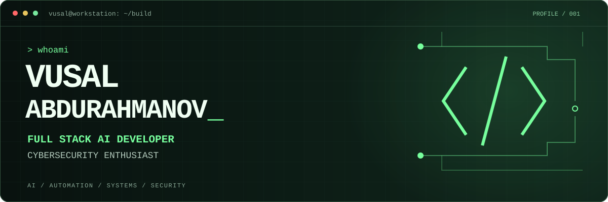

<p align="center">
  
</p>

<p align="center">
  <b>Full Stack AI Developer &nbsp; / &nbsp; Cybersecurity Enthusiast</b><br />
  Building useful software. Exploring how systems work and how they break.
</p>

---

### `01 / whoami`

I'm **Vusal Abdurahmanov**. I build across the stack: interfaces, APIs, AI agents, automation, and the infrastructure that connects them.

My work lives where **AI engineering**, **product development**, and **security curiosity** meet. I like shipping tools that solve real problems, understanding what happens under the hood, and making systems more resilient.

```text
vusal@workstation:~$ cat interests.conf

build     = full-stack apps, AI agents, MCP servers
automate  = workflows, search, developer tools
explore   = cybersecurity, application security, reverse engineering
ship      = practical products, clean APIs, useful interfaces
```

### `02 / toolkit`

<p>
  
</p>

**Languages** &nbsp; Python / TypeScript / JavaScript / Go<br />
**Web & APIs** &nbsp; React / Next.js / Node.js / FastAPI<br />
**Mobile & infrastructure** &nbsp; Flutter / PostgreSQL / Docker / Linux

### `03 / selected builds`

| Project | What it does |
| :--- | :--- |
| [**deep-search-mcp**](https://github.com/VusalAbdurahmanovX/deep-search-mcp) | Self-hosted MCP search server with Azerbaijani marketplace integrations. |
| [**Speech-to-text**](https://github.com/VusalAbdurahmanovX/Speech-to-text) | Local, CUDA-accelerated transcription for Windows with editable transcripts and subtitle export. |
| [**CryptoPayments**](https://github.com/VusalAbdurahmanovX/CryptoPayments) | Self-hosted Go API for USDT BEP20 payments, invoice addresses, and signed webhooks. |

### `04 / connect`

Find my projects and start a conversation on [**GitHub @VusalAbdurahmanovX**](https://github.com/VusalAbdurahmanovX).

---

<p align="center"><code>BUILD WITH INTENT. QUESTION THE SYSTEM. KEEP EXPLORING.</code></p>
